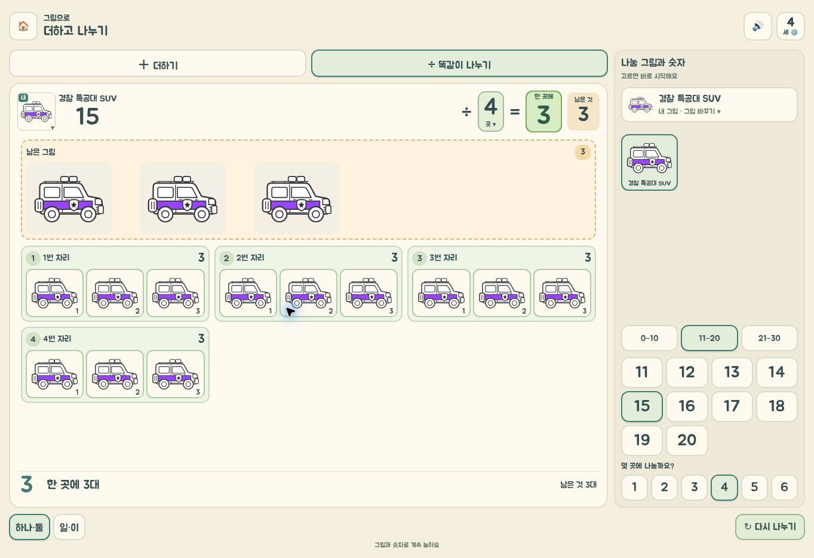
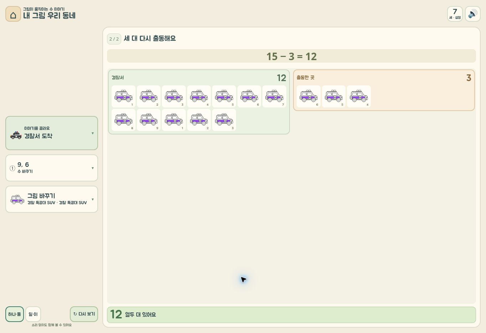

# 시현이놀이터 세 단계 진행 보고

기준일: 2026-11-16. 대상 저장소: `icefoxtail/my-life-os`.

운영 주소: https://icefoxtail.github.io/my-life-os/index.html

## 현재 판정

| 순위 | 승인 범위 | 상태 |
| --- | --- | --- |
| 1 | 견본과 내 작품을 나란히 보고 부분·색 안내로 색칠하기 | 운영 반영·확인 완료 |
| 2 | 수 비교·빼기 및 열 칸을 채우는 수를 식으로 보여 주기 | 운영 반영·확인 완료 |
| 3 | 내 작품으로 연산하고 4–7세별 동네 이야기를 자동으로 보기 | 운영 반영·확인 완료 |

## 1순위 — 견본과 함께 색칠하기

그림판에 견본을 함께 볼 수 있는 영역과 다음 부분 안내를 추가했다. 아이가 칠한 작품과 견본을 구분해서 보여 주며 기존 작품의 색과 판본, 되돌리기를 유지한다. 직접 운영 화면에서 기존 작품 색 유지, 색칠·되돌리기·새로고침, 내 작품의 숫자 세기 사용을 확인했다.

- PR: https://github.com/icefoxtail/my-life-os/pull/30
- 운영 기준 merge: `6f6c739ee75cb215bf0a1768d62b50d649fa7a78`.
- 실제 운영 메뉴 검사: 7/7. 운영 런타임4파일·검사 소스6개 해시 일치.
- 운영 검사: https://github.com/icefoxtail/my-life-os/actions/runs/43814183284
- 보존된 근거: `ci/stage1/production/`.

## 2순위 — 비교·빼기·열 칸 채우기

비교에서는 양쪽 그림이 자동으로 짝을 이룬 뒤 남는 수와 차이를 보여 준다. 빼기에서는 원래 있던 그림이 이동하고 남은 수가 바뀐다. 열 칸 정원은 현재 수와 더 필요한 수를 함께 표시하며, 예를 들어 7개에서는 `7+3=10`과 남은 세 칸을 연결한다.

직접 운영 메뉴에서 15와12의12쌍·차이3, 15−4의남음11·출동4, 7에서열칸완성을 확인했다. 수를 나이별로 제한하지 않는다. 자동 진행과 기존 공용 음성·설정을 유지한다.

- PR: https://github.com/icefoxtail/my-life-os/pull/31
- 운영 기준 merge: `9d28ef0bab06859df0d3432ad4a8191c18394870`.
- 후보 기존 놀이 브라우저 검사: 76/76.
- 실제 운영 검사: 비교·빼기16/16, 열 칸 정원14/14, 합계30/30.
- 운영 런타임8파일·검사 소스22개 기록 해시 일치, 브라우저 pageErrors 없음.
- 운영 검사: https://github.com/icefoxtail/my-life-os/actions/runs/43820498604
- 보존된 근거: `ci/stage2/production/`.

## 3순위 — 내 그림과 우리 동네 이야기

그림으로 더하고 나누기, 비교·빼기, 새 이야기 놀이에서 추천 그림과 내 그림을 고를 수 있다. 그림 종류와 출처 선택을 저장하고, 색은 기존 작품에서 읽어 반영한다. 기존 작품을 지운 경우에는 수와 선택 의도를 유지하면서 해당 견본과 짧은 안내로 이어 간다.

숫자나라의 **내 그림 우리 동네**에는 네 상황이 있다.

| 상황 | 기본 흐름 | 7세의 연결 흐름 예시 |
| --- | --- | --- |
| 소방서 출동 | 15대에서4대가 출동하여11대가 남음 | 떠난 원본2대가 돌아와13대 |
| 경찰서 도착 | 9대에6대가 도착하여15대 | 그중3대가 출동하여12대 |
| 간식 나누기 | 15개를4곳에 나누어 각3개·남음3개 | 12개에3개를 배달한 뒤 같은 간식을 나눔 |
| 우리 동네 | 7개와5개를 짝지어 차이2를 봄 | 적은 쪽에2개가 도착해 같아짐 |

위 수는 기본 예시이며 사용자가 고른 수에 맞춰 장면이 달라진다. 7세 연결 장면의 수는 자동으로 정해진다. 돌아오는 수는 떠났던 수 안에서 최대2, 다시 출동하는 수와 배달분은 해당 수 안에서 최대3이며, 비교 장면은 차이만큼 채운다. 사용자가 고른 기본 수는 바꾸지 않는다. 모든 나이에서0–30을 선택할 수 있다. 빼는 수는 원래 수 이하, 덧셈 합계는30이하, 나누는 곳은1–6곳이다. 비교는 양쪽 각각0–30이다.

| 나이 설정 | 실제 동작 |
| --- | --- |
| 4세 | 한 상황을 자동으로 진행 |
| 5세 | 두 가지 예측 중 고르거나 건너뛰기; 응답이 없어도3초 뒤 진행 |
| 6세 | 같은 원본 그림을 열 묶음과 낱개로 정리 |
| 7세 | 첫 결과를 다음 상황에 사용하여 두 단계 진행 |

이동·복귀·나누기·열 칸 배치 때 같은 원본 그림을 유지한다. 별도 클릭으로 모든 그림을 하나씩 세어야 하는 방식은 아니다.

### 3순위 검증 상태

- PR: https://github.com/icefoxtail/my-life-os/pull/33
- 수정 후보: `cc267b9cc2513cfbea0c01c47e66210cfaed7b69`.
- 개인 작품 helper8그룹 통과. 이야기 모델 유효 입력8,556개·잘못된 입력3,849개·이벤트121,980개 검증 통과.
- 첫 브라우저 후보는 기존75/76, 신규20/21이었다. 태블릿의 나누기 버튼 잘림과 작은 세로 화면의 이름/식 경계 문제를 확인해 CSS로 수정했다. QA기준·계산·저장 동작은 바꾸지 않았다.
- 수정 후보의 기존76/76·신규21/21, 총97/97이 통과했다. 소스63개 기록이 정확한 후보와 일치하고 브라우저 pageErrors는 없다. 두 화면 수정은 Root와 별도 검토자가 실제 PNG로 확인했다.
- main `0b90bd0ceab618c76bba4651d1e85a7afc557f3a`에 정상 병합했다. main tree는 검증 후보와 같다. Pages 배포와 실제 운영 메뉴21/21검사를 통과했고, 운영 파일12개·보고서 source17개가 main과 일치했다. 브라우저 pageErrors는 없다.
- 후보 검사: https://github.com/icefoxtail/my-life-os/actions/runs/43825567992
- 운영 검사: https://github.com/icefoxtail/my-life-os/actions/runs/43828299940
- 보존된 근거: `ci/stage3/browser/`, `ci/stage3/production/`, 첫 실패와 수정 근거는 `ci/stage3/first-candidate/`.

### 직접 확인한 운영 화면

기존에 열어 둔 운영 탭을 한 번 새로고침한 뒤 새 메뉴와 기존 작품을 확인했다. 그림판 작품은 변경하지 않았다.

- 보라색 경찰 특공대 SUV15대를 네 곳에 나누어 각3대·남음3대가 되는 것을 확인했다.
- 같은 개인 작품15대에서4대가 이동하여11대가 남는 것을 확인했다.
- 7세 경찰서 이야기에서 처음9대와 도착6대를 모두 개인 작품으로 선택했다. `9+6=15` 다음에3대가 출동하여 `15−3=12`로 이어졌으며, 전체15개의 개인 색을 확인했다.
- 6세에서 같은15대가 열 묶음10대와 낱개5대로 정리됐다.
- 원래4세·한국어 설정으로 복원한 뒤1/1단계의 `9+6=15` 완료와15개의 개인 색을 확인했다.

## 확인 범위와 후속 계획

브라우저에서는 실제 메뉴 조작, 그림 색·판본·삭제 시 전환, 자동 수량 변화, 원본 유지, 설정·홈 이동·재입장, 음성 실패 시 완료, 주요 화면 크기를 확인한다. 실제 휴대폰/태블릿의 손가락 조작과 스피커 청취는 직접 수행하기 전까지 미확인이다.

다음 작업은 `NEXT-STEPS.md`에 정리했다. 먼저 실제 기기에서5–10분 함께 놀며 속도·안내·터치 위치를 확인하고, 필요한 고정 이야기 안내 녹음을 보강한다. 그 사용 결과에 따라 좋아하는 그림과 최근 놀이로 바로 이어 들어가는 동선을 검토한다. 후속 작업은 이번 세 단계 승인 범위 이후의 제안이다.
