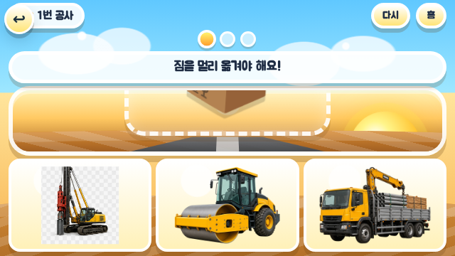
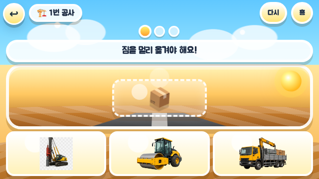
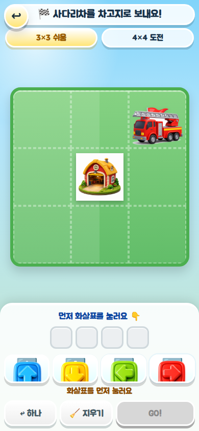
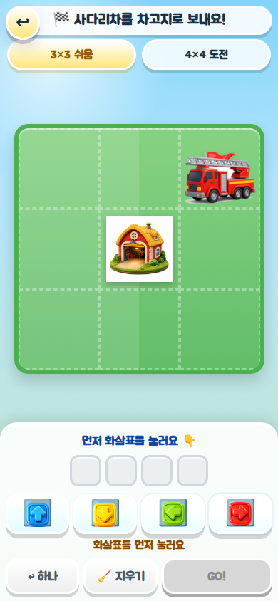
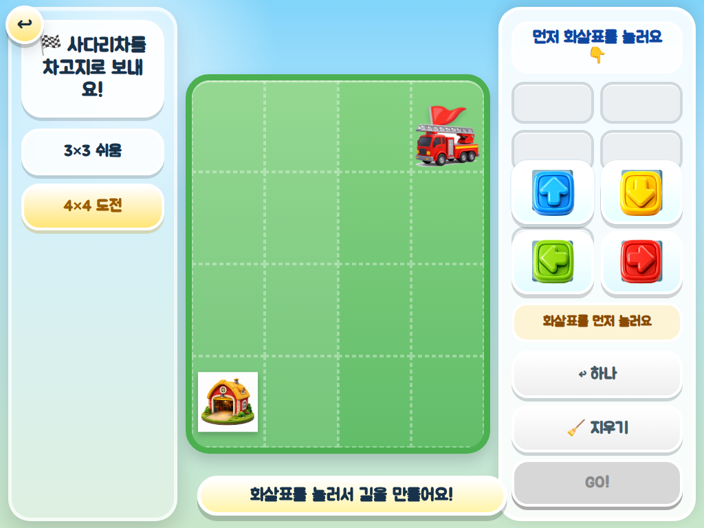
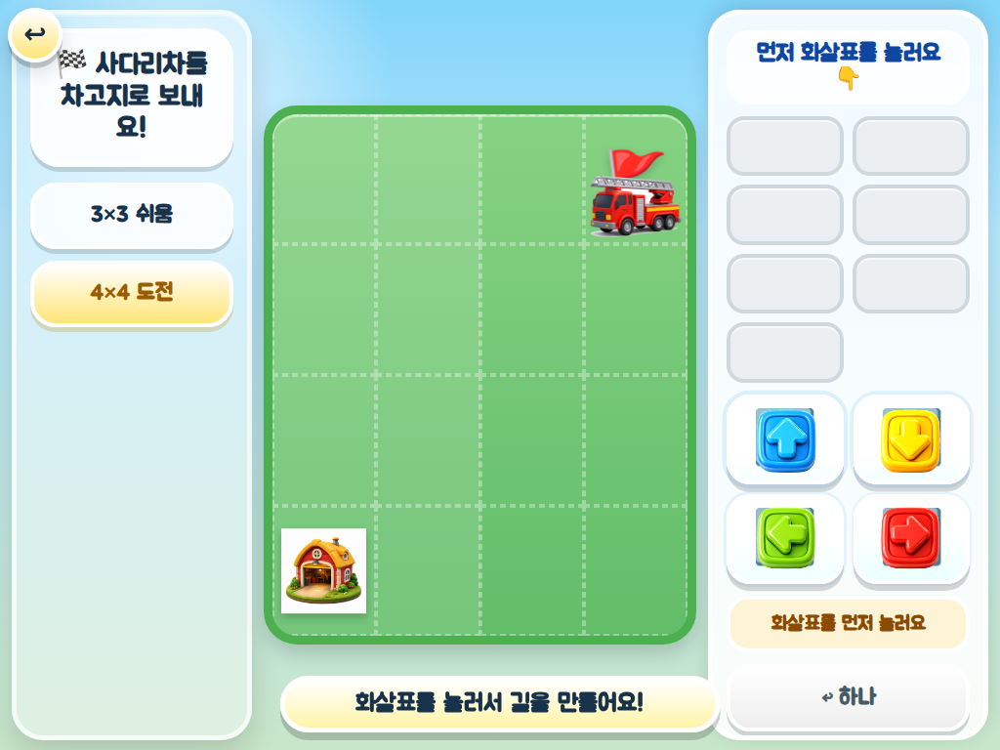
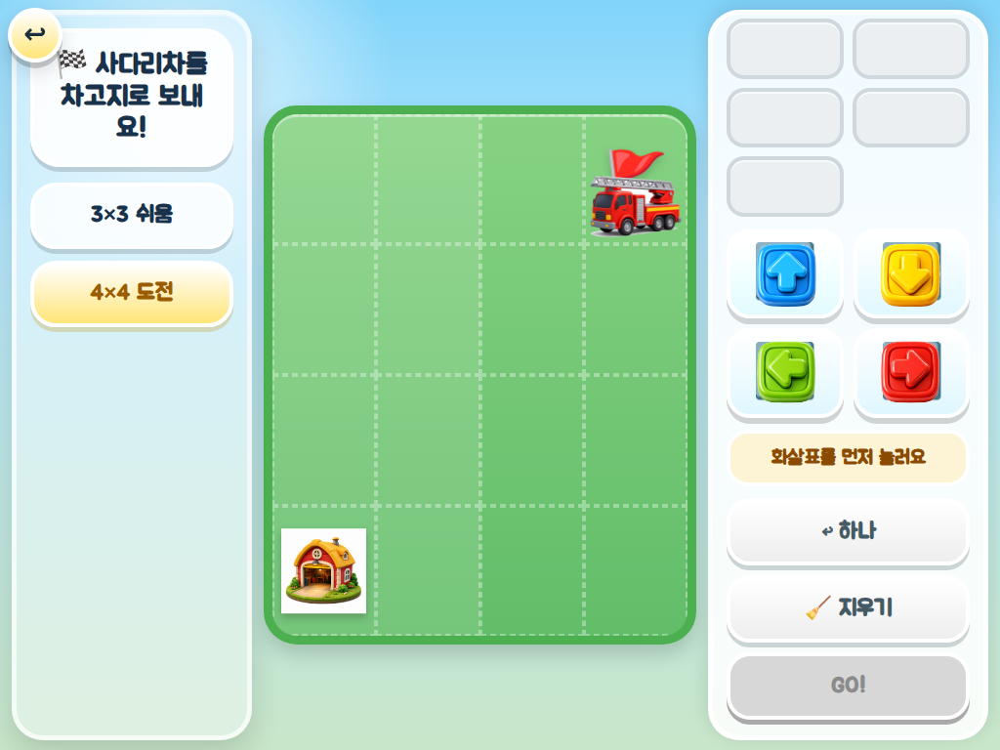

# 작은 화면 UI 개선 — 병합 승인 대기

작성일: 2026-11-17 KST. 저장소: `icefoxtail/my-life-os`.

공사장 640×360의 중앙 목표 장면 잘림과 코딩 자동차 390×844의 화살표 잘림을 기준 main에서 재현하고 수정했다. 제품 변경은 **두 게임의 `injectStyle()` CSS만**이다. 최종 제품 바이트에 연결되는 추가 검증은 **공사장 12/12, 코딩 자동차 12/12, 합계 24/24 PASS**다. 여섯 화면 크기에서 배치와 터치 흐름을 확인했으며, 독립 화면 검수에서 발견한 태블릿 명령칸 겹침도 함께 해결했다.

**main 병합과 운영 배포는 하지 않았다. 사용자의 병합 승인을 기다린다.** 검토 브랜치는 `fix/small-screen-clipping-20261117`이다. 새 PR은 만들지 않았으며, 이전 완료 PR #35·#36·#37을 다시 열거나 변경하지 않았다.

## 1. 기준과 검토 범위

| 항목 | 확인한 판본 |
|---|---|
| 작업 시작 시 최신 main 및 원문 재현 기준 | `23fd7f9af6e28034d1a6a3062e293742b3d66cb7` |
| 마감 시 재확인한 최신 main | `c3839fc34b94f6b6bf47b0c86a1c8bce187acb89` |
| 최종 제품 CSS가 완성된 커밋 | `255408ebbaed10d4cdf27a1c9d7c5900274f0e3b` |
| 최종 태블릿 검사 커밋 | `b29bd80dbbe61bc9e9038969831cbde5658a4699` |
| 기존 차량/Pixi 종료 보고서 | [vehicle-closeout-20261116/REPORT.md](../vehicle-closeout-20261116/REPORT.md) |

작업 중 main에 추가된 것은 `creator-upgrade-20261116`의 `PROGRESS.md`, `RELEASE_EVIDENCE.json`, `STAGE2.md` 세 문서뿐이었다. 최초 기준과 최신 main의 제품 파일은 동일하다. 최신 main과 검토 브랜치의 `git merge-tree --write-tree` 사전 확인도 충돌 없이 종료했다. 이 확인은 실제 main 병합이 아니다.

검사 대상은 두 게임의 상시 표시 요소, 목표 장면, 화살표, 명령칸, 버튼, 완료 패널과 복귀 흐름이다. 배경 장식과 차량의 진입·퇴장, 일시적인 축하 말풍선 애니메이션 전체에 대해 무겹침을 보증하는 검사는 아니다.

## 2. 수정 전후

### 공사장 — 640×360

낮은 가로 화면에서 선택 카드의 이미지 래퍼가 화면 폭에 따라 약 115px 높이를 차지했다. 중앙 장면에 남은 내부 높이는 86px였지만 목표 영역은 약 173px 높이를 유지했다. 목표 영역 상단이 장면의 클리핑 경계보다 약 109px 위로 나가면서 중앙 그림이 잘렸다.

높이 500px 이하 가로 화면에서 이미지 래퍼를 70px로 맞추고, 목표·결과 영역을 실제 남은 장면 높이에 맞췄다. 듣기 버튼이 있는 질문 카드의 배치와 완료 패널 여백도 조정했다. 복귀 버튼과 제목이 겹치지 않도록 필요한 공간을 확보하고 조작 버튼은 최소 44×44 CSS px를 유지했다.

| 측정 | 수정 전 | 수정 후 |
|---|---:|---:|
| 장면 내부 세로 구간 | y=127–213 | y=135–254 |
| 장면 내부 높이 | 86px | 119px |
| 목표 영역 높이 | 172.80px | 76.16px |
| 목표 영역 세로 구간 | y=17.72–190.52 | y=158.81–234.97 |
| 목표 영역 전체가 장면 안에 포함 | FAIL | PASS |

| 수정 전 | 수정 후 |
|---|---|
|  |  |

같은 실행에서 [듣기 버튼이 있는 미션](evidence/43903458052/after/construction-640x360-pump.png)과 [완료 패널](evidence/43903458052/after/construction-640x360-complete.png)도 확인했다. 측정 원문은 각 PNG 옆 JSON과 [공사장 포함 원시 결과](evidence/43903458052/after/small-screen-ui-results.json)에 보존했다.

### 코딩 자동차 — 390×844

화살표 버튼은 56px 높이인데 내부 CSS Grid의 자동 최소 크기가 이미지의 비율 계산에 영향을 주어 약 67.16px 행을 만들었다. 이미지의 실제 불투명 영역이 버튼 내부 하단을 약 16.33–19.47px 벗어나 잘렸다.

화살표 버튼의 Grid 행·열에 `minmax(0, 1fr)`를 지정하고 이미지의 최소 크기를 0으로 정했다. 기존 이미지와 버튼 외형 높이는 유지하면서 내부 그림만 버튼에 맞게 계산된다. 난이도와 복귀 버튼의 최소 터치 크기도 44px로 맞췄다.

| 측정 | 수정 전 | 수정 후 |
|---|---:|---:|
| 화살표 버튼 높이 | 56px | 56px |
| 내부 Grid 행 높이 | 67.16px | 40px |
| 이미지 요소 높이 | 61.78px | 36.80px |
| 불투명 그림의 하단 경계 | 내부 하단보다 16.33–19.47px 초과 | 내부 하단까지 6.61–8.48px 여유 |
| 네 화살표 전체 포함 | FAIL | PASS |

| 수정 전 | 수정 후 |
|---|---|
|  |  |

### 태블릿 가로 — 1024×768

첫 후보의 자동 검사는 24행을 통과했지만, 독립 육안 검수에서 코딩 명령칸이 화살표 아래에 겹치는 문제를 발견했다. 당시 검사에 명령칸 경계 확인이 없었으므로 첫 후보의 코딩 결과를 최종 판정에 사용하지 않았다.

태블릿 가로 패널의 자동 Grid 행이 내용보다 작게 압축되는 것이 원인이었다. 높이 701px 이상 가로 화면에 `grid-auto-rows: max-content`를 추가해 명령칸의 실제 높이를 보존했다. 오른쪽 패널에는 기존 세로 스크롤을 유지하고 `safe center`, `touch-action: pan-y`를 적용했다. 지도와 왼쪽 난이도 영역은 움직이지 않는다.

쉬움 4칸과 도전 7칸이 모두 분리되어 보이며, 하단으로 스크롤하면 화살표·한 칸 취소·지우기·GO 전체에 접근할 수 있다. 상단 안내와 하단 GO를 항상 동시에 보여 주는 배치는 아니다.

| 도전 모드 수정 전 | 수정 후 상단 | 수정 후 하단 |
|---|---|---|
|  |  |  |

직접 터치 시작·이동·종료 입력을 사용한 Chromium 검사에서 쉬움 패널은 `0→29px`, 도전 패널은 `0→170px`로 최대 위치까지 이동했다. 네 제스처 모두 신뢰된 touch 이벤트와 실제 scroll 이벤트가 기록됐다. 명령칸 전체 표시, 각 조작부 접근, GO 실행, 완료와 홈 복귀를 확인했다.

## 3. 정확한 변경 파일과 영향

| 파일 | 변경 규모 및 영향 |
|---|---|
| [`js/games/construction-site.js`](../../../js/games/construction-site.js) | **+21/−5행**. `injectStyle()` 안의 버튼 최소 크기, 낮은 가로 화면의 목표·결과 장면, 질문·선택 카드, 완료 패널 CSS. |
| [`js/games/coding-car.js`](../../../js/games/coding-car.js) | **+20/−5행**. `injectStyle()` 안의 화살표 Grid 크기, 최소 터치 크기, 세로 스크롤, 태블릿 명령칸 행 높이 CSS. |
| [`scripts/qa-small-screen-ui-browser.py`](../../../scripts/qa-small-screen-ui-browser.py) | 신규 검사 도구. 두 게임의 배치·터치·홈 복귀, 슬롯 겹침, 실제 입력에 의한 스크롤, 소스 해시 및 원본 화면 수집. 제품에서 로드하지 않는다. |
| [`.github/workflows/small-screen-ui-review.yml`](../../../.github/workflows/small-screen-ui-review.yml) | 검토 브랜치 전용 CI. 마지막 실행은 남은 태블릿 2행만 수행한다. 운영 배포 작업은 포함하지 않는다. |
| `docs/operations/small-screen-ui-20261117/` | 이 보고서, 보존 확인, 최종 판정·소스 연결 기록, 독립 검수 및 원시 결과·화면. 제품 UI에 영향 없음. 전체 증거 파일은 `SHA256SUMS`에 열거한다. |

제품 소스의 전체 diff는 **+41/−10행**이다. 두 파일에서 CSS 문자열을 제외한 나머지 바이트는 기준 main과 동일하다. 게임 상태·정답 판정·음성 호출·보상·타이머·이미지 선택 로직을 수정하지 않았다.

이번 기준 main에서 후보까지 `index.html`, `sw.js`, 전체 `assets`, 공용 `js/vehicle-display.js`, Pixi 엔진 및 Pixi 게임 파일의 변경은 0개다. 다른 게임의 메뉴나 진입 경로도 변경하지 않았다.

## 4. 추가 검증 결과

모든 칸은 해당 화면의 **레이아웃 1행 + 터치 흐름 1행**을 의미한다. 아래 24행은 중복 없이 채택한 최종 유효 결과다. 한 번의 실행에서 최종 24행을 새로 돌린 것으로 표현하지 않는다.

| 화면 | 공사장 | 코딩 자동차 | 확인 범위 |
|---|---:|---:|---|
| 모바일 세로 390×844 | 2/2 PASS | 2/2 PASS | 목표 장면·화살표·터치·완료·복귀 |
| 모바일 가로 844×390 | 2/2 PASS | 2/2 PASS | 낮은 가로 배치·터치·완료·복귀 |
| 작은 모바일 가로 640×360 | 2/2 PASS | 2/2 PASS | 원래 장면 잘림·질문·완료 패널·조작부 |
| 작은 모바일 세로 360×640 | 2/2 PASS | 2/2 PASS | 좁은 폭·터치·완료·복귀 |
| 태블릿 세로 768×1024 | 2/2 PASS | 2/2 PASS | 확장된 배치·터치·완료·복귀 |
| 태블릿 가로 1024×768 | 2/2 PASS | 2/2 PASS | 명령칸·실제 패널 스크롤·GO·복귀 |
| **합계** | **12/12 PASS** | **12/12 PASS** | **24/24, pageErrors 0** |

공사장은 3개 미션 진행, 듣기 버튼이 있는 단계, 결과·완료 화면, 화면 회전 후 단계 유지와 홈 복귀·재진입을 검사했다. 코딩 자동차는 쉬움·도전의 4/7개 명령칸, 네 방향 화살표, 한 칸 취소, 지우기 버튼의 터치 영역, GO 경로 실행, 완료 패널, 회전 후 명령 유지와 복귀·재진입을 검사했다.

검사 대상 버튼은 최소 44×44 CSS px를 충족하고, 현재 화면 또는 정상 스크롤 후 전체가 보이며 터치 중심점에 다른 요소가 덮이지 않는지 확인했다. 페이지 수평 넘침은 발견하지 않았다. 코딩 자동차는 현재 제품 메뉴에 공개 카드가 없으므로 기존 내부 진입 함수 `openCodingCarGame()`으로 열었고, 게임 내부의 터치와 홈 복귀는 실제 입력으로 검사했다.

### 증거 재사용과 실패 기록

| 실행 | 실제 원시 결과 | 최종 채택 |
|---|---|---|
| [43903458052](https://github.com/icefoxtail/my-life-os/actions/runs/43903458052) | 기준 main의 원래 두 결함을 FAIL로 재현. 첫 후보 자동 24/24 PASS 후 독립 검수에서 태블릿 명령칸 문제 발견. | 이후 바이트가 동일한 **공사장 12행만** 채택. 첫 후보 코딩 결과는 채택하지 않음. |
| [43905541853](https://github.com/icefoxtail/my-life-os/actions/runs/43905541853) | 첫 후보 태블릿 쉬움·도전의 겹침을 재현. 수정 후 코딩 **11/12**, 태블릿 터치 흐름 1행 FAIL. | **1024×768 외 다섯 크기의 10행** 채택. |
| [43907162447](https://github.com/icefoxtail/my-life-os/actions/runs/43907162447) | 같은 제품 바이트에서 직접 touchStart/move/end 입력으로 태블릿 **2/2 PASS**. | **태블릿 2행** 채택. |

두 번째 실행의 `Input.synthesizeScrollGesture`는 패널을 움직이지 못했다. 마지막 실행에서 제품 파일을 수정하지 않고 검사 입력을 `Input.dispatchTouchEvent`로 바꾸자 실제 터치 이벤트와 스크롤 이동이 기록됐다. 원래 실패 결과는 그대로 남겼으며 검사 기준을 완화하거나 `scrollTop`을 강제로 바꾸지 않았다.

최종 유효 결과와 현재 제품 파일의 연결은 [VALIDATION.json](VALIDATION.json)에 기록했다. 첫 실행과 최종 공사장 소스 해시가 같고, 두 번째·세 번째 실행의 코딩 소스 해시도 같다. 공통 HTML·서비스 워커·표시 helper·표시 경계 데이터는 세 실행에서 같다. 각 실행 전후에도 소스 해시가 유지됐다.

## 5. 138개 이미지 및 기존 38/38·7/7 재사용

기존 차량 **38/38** 및 Pixi **7/7**은 완료된 운영 검증 결과로 보존했다. 이번 차수에서는 전체 브라우저 검사를 다시 실행하지 않았다.

- 표시 경계 manifest의 이미지 **138개**와 `assets/vehicles` tree는 이번 작업에서 그대로다.
- 승인 원장 76개 파일의 `resultSha256`과 현재 파일을 직접 대조해 **불일치 0개**를 확인했다.
- 차량 자산 tree는 이전 운영 제품 `b6719ff`, 이번 기준 `23fd7f9`, 최종 제품에서 모두 `ab47b27cb49e50aeeea3b4c85f2e27c24fa0fabb`다.
- 공용 표시 helper, 표시 경계 JSON, Pixi 엔진·게임도 기존 검증 판본과 동일하다.

근거는 [PRESERVATION.json](PRESERVATION.json), [기존 차량 실행](https://github.com/icefoxtail/my-life-os/actions/runs/43869275111), [기존 Pixi 실행](https://github.com/icefoxtail/my-life-os/actions/runs/43869274835)이다.

기존 운영 제품과 이번 시작 main 사이에는 다른 작업으로 공사장·megaDispatch·number-count·vehicle-memory·서비스 워커가 이미 변경돼 있었다. 따라서 기존 38/38 전체를 “최신 코드와 완전히 같은 판본의 새 PASS”라고 주장하지 않는다. 변경되지 않은 자산·공용 표시·Pixi의 기존 근거를 재사용하고, 이번 두 게임의 변경 부분을 위의 별도 증거로 보완했다.

## 6. 독립 검수 및 검사 한계

구현 담당과 분리한 교차 검수로 공사장 화면, 코딩 화면, 태블릿 명령칸과 상·하단 스크롤 화면을 확인했다. 독립 결과는 [INDEPENDENT_REVIEW.md](INDEPENDENT_REVIEW.md)에 기록했다. 자동 검사에서 누락됐던 태블릿 문제를 찾아 수정했으며, 원시 FAIL과 최종 PASS를 함께 보존했다.

브라우저는 GitHub Actions의 Chromium **143.0.7499.4**, Playwright **1.57.0**이며 터치 입력을 에뮬레이션했다. 로컬 Chromium은 환경의 소켓 제한으로 실행하지 못해 원격 CI의 실제 브라우저를 사용했다. 물리 휴대폰·태블릿, iOS Safari 및 실물 스피커 청취는 **NOT_RUN**이다. 기존 음성 검사 probe로 오디오 완료만 모의했고 제품의 음성 코드나 음원은 수정하지 않았다. 서비스 워커를 차단한 검사 서버에서 새 소스를 확인했으므로 운영 캐시 갱신 검사는 아직 하지 않았다.

## 7. 승인할 대상

승인 대상은 검토 브랜치에 담긴 두 게임의 CSS 수정, 재현 가능한 검사 도구 및 증거 기록이다. 검토용 비교는 [main…fix/small-screen-clipping-20261117](https://github.com/icefoxtail/my-life-os/compare/main...fix/small-screen-clipping-20261117)에서 볼 수 있다.

사용자가 main 병합을 승인한 뒤 현재 main을 다시 확인하고, 기존 배포 경로를 통해 운영에 반영할 수 있다. 이 보고서의 완료 범위는 **수정·영향 범위 검수·추가 검증·승인용 자료 준비**까지이며, **main 병합과 운영 반영은 승인 대기**다.
