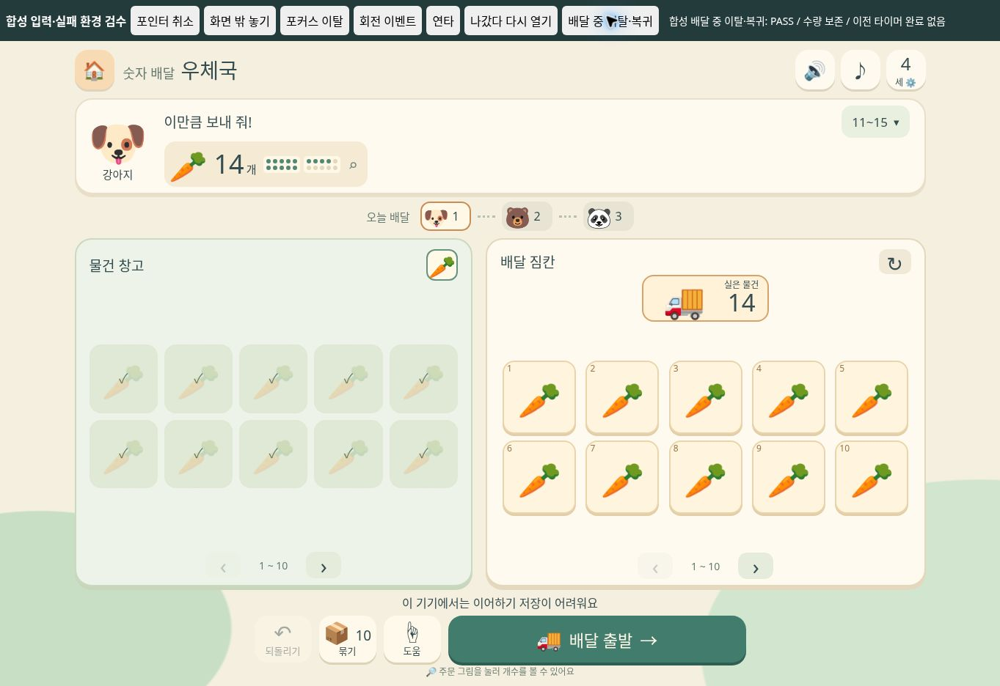
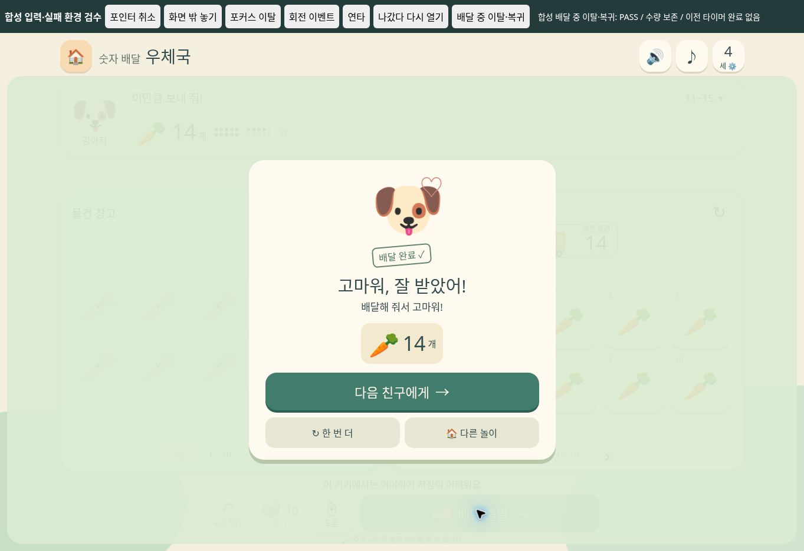

# 숫자 배달 우체국 — 실패 환경·복귀 브라우저 검수

## 환경과 증거 경계

2026-11-07, 구현 담당자가 공유 Chromium의 CUA 탭 35에서 `http://127.0.0.1:8771/scripts/qa/post-office-failure.html`을 열어 검수했다. 화면은 1363×936이며 한 탭만 조작했다. 검수 후 탭을 닫았다.

이 하네스는 실제 제품의 모델·UI·CSS를 불러오고, 다음 실패 환경만 격리해서 만든다.

- 이미지의 상대 경로가 없는 하네스 경로에서 실행한다. 브라우저가 로드에 실패한 이미지에는 제품의 이모지 대체 처리가 적용된다.
- 음성 엔진을 로드하지 않아 제품의 그림 안내 대체를 확인한다. 실제 TTS 음질·발음·스피커 재생이나 특정 OS 음성 장애 검증은 아니다.
- localStorage는 읽기 시 null, 쓰기 시 SecurityError를 내는 모의 어댑터다. 다른 검수 탭의 실제 저장값을 변경하지 않는다. 실제 저장 공간 부족·사생활 보호 모드 검증은 아니다.
- 상단 시험 버튼은 합성 PointerEvent/MouseEvent 또는 공개 UI 버튼의 click, 공개 게임 생명주기 render/destroy를 사용한다. 결과 비교만 읽기 전용 snapshot API를 사용하며, 게임 수량 상태를 직접 덮어쓰지 않는다.

물리적인 터치, OS의 실제 회전, 실제 포인터 캡처 해제와 합성 이벤트 검증은 구분한다. 실제 CUA 드래그/모바일 크기 검수는 별도의 통합·독립 브라우저 기록을 따른다.

## 상단 7개 시험 버튼을 실제로 눌러 확인한 결과

| 시험 | 관찰 결과 |
|---|---|
| 포인터 취소 | 합성 pointerdown → move → pointercancel → 늦은 compatibility click 후 위치·수량 유지, 잔상 0개 |
| 화면 밖 놓기 | 합성 드래그 후 창고/차가 없는 지점에서 pointerup, 위치·수량 유지, 잔상 0개 |
| 포커스 이탈 | 드래그 중 합성 window blur, 위치·수량 유지, 잔상 0개 |
| 회전 이벤트 | 드래그 중 합성 orientationchange, 위치·수량 유지, 잔상 0개. 실제 뷰포트 회전은 이 버튼의 검증 범위가 아님 |
| 연타 | 같은 물체 ID를 창고에서 싣고 즉시 짐칸에서 다시 누르는 두 입력 중 첫 이동만 수락. 실제 수량 0 → 1 |
| 나갔다 다시 열기 | 저장 쓰기가 거부되는 동안 destroy → render 후 1개 적재 상태를 메모리에서 복원 |
| 배달 중 이탈·복귀 | 공개 UI로 당근 14개를 싣고 배달 시작 → 즉시 destroy/render. 14개 위치를 보존한 SELECTING으로 복귀, 2.6초 뒤에도 이전 타이머의 완료 처리 없음 |

7개 버튼은 각각 화면에 PASS를 표시했고, 매 버튼 뒤 접근성 트리에서 결과를 직접 확인했다. 합성 시험 결과를 실제 기기 PASS라고 표시하지 않는다.

## 실패 대체의 실제 표시와 게임 완료

복귀 직후 DOM에서 `.npo-picture img` 27개 모두 로드 완료 상태이면서 naturalWidth=0임을 확인했다. 같은 27개 모두 `missing` 대체 클래스가 붙었고 화면에서 동물·당근·차 이모지가 보였다. 주문 그림 안내 문구와 “이 기기에서는 이어하기 저장이 어려워요” 안내도 표시됐다.

이 상태에서 구현 담당자가 제품의 **배달 출발** 버튼을 CUA로 직접 눌렀다. 상자를 닫는 화면을 거쳐 강아지가 당근 14개를 받은 완료창, 감사 반응, 다음 친구·한 번 더·다른 놀이 버튼을 확인했다. 음성 엔진·이미지 원본·영구 저장이 없는 조건에서도 이 한 주문은 끝까지 동작했다.

수정 후 결과 레이어가 화면 가로 영역을 채우고 완료 카드·세 버튼이 잘리지 않는 것도 위 화면에서 확인했다. 처음 독립 검수에서 발견한 약 328px 폭 축소 상태가 아니다.

## 대상 파일 SHA-256

| 파일 | SHA-256 |
|---|---|
| 모델 | `e38eb927b6e5a4678bf151284f1961de92fc3c87aee289e5a0c2174514347c0d` |
| UI | `157d7fd888d2cd0d52ed0c7333f4af058636bab07456551576d4606eb7e3571d` |
| CSS | `e854338ff85ae655888118dbf843a9de5f3159ad23f730ab9991885b1eb87d73` |
| 실패 하네스 | `1dd6eb446d55c309dfd9091f9ce67ef265a8a5983e14cd6e3c948b5180e28366` |

하네스는 메뉴와 service worker 캐시 목록에 노출하지 않는 개발용 재현 페이지다. 실제 iOS/Android 기기, 음성 실청취, 시현이의 놀이 관찰은 미실시다.

## 이 브라우저 검수 이후의 저장 수정

독립 최종 검수에서 **읽기는 되지만 쓰기만 실패하고 기존 저장이 남아 있는 경우**를 추가 발견했다. 이 하네스는 읽기 시 null을 반환하므로 그 경계까지 검증한 것은 아니다. 이후 UI의 저장 읽기 우선순위만 수정하고 [별도 production closure 회귀](storage-write-failure-review.md)로 재현·수정 결과를 남겼다. 위 화면과 SHA는 실제 브라우저 실행 당시의 기록으로 유지한다.
