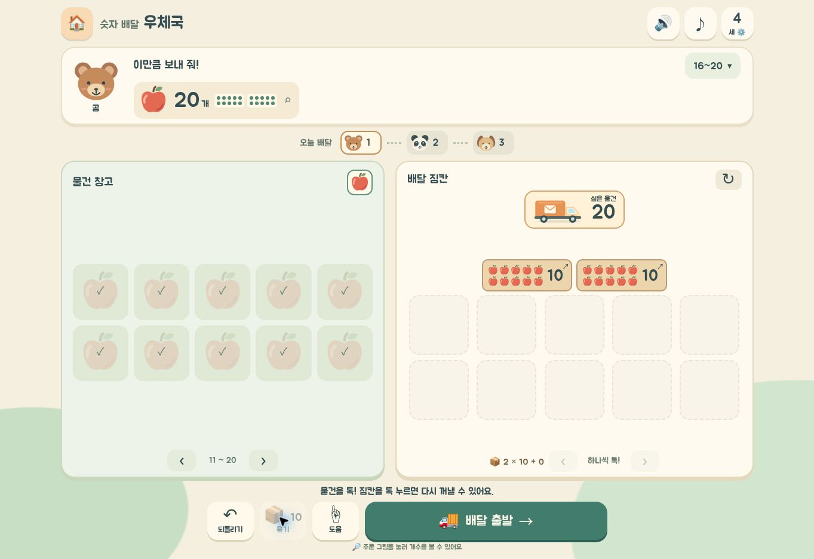
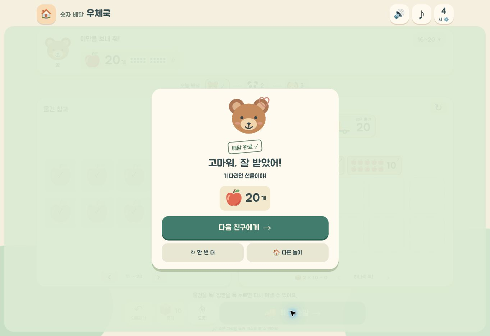

# 시현이 놀이터 — 운영 배포 확인

검수일: 2026-11-07 UTC. 운영 화면의 최종 수령 상태를 15:50 UTC 이전에 직접 관찰했습니다.

## 배포 기준

| 항목 | 확인 결과 |
| --- | --- |
| PR | [#4 — merged](https://github.com/icefoxtail/my-life-os/pull/4) |
| 최종 구현 head | `8031e91b3f01b302d9dd64db387e4532ea5a9753` |
| 병합 main | `58eb1fad34bba957812b08cf55bdf28c5595ca60` |
| 최종 소스 tree | `0f4d5522f3015c6f04208a609fa0f8604800c320` |
| PR 최종 CI | [42387821664 — success](https://github.com/icefoxtail/my-life-os/actions/runs/42387821664) |
| main CI | [42387871802 — success](https://github.com/icefoxtail/my-life-os/actions/runs/42387871802) |
| GitHub Pages | [42387871490 — success](https://github.com/icefoxtail/my-life-os/actions/runs/42387871490), 2026-11-07T15:45:54Z 완료 |
| 실제 운영 주소 | [시현이 놀이터](https://icefoxtail.github.io/my-life-os/index.html) |

원격 GitHub API에서 main commit과 tree, 해당 SHA의 CI 및 Pages 성공을 확인한 뒤 새 운영 사이트 탭으로 직접 진입했습니다. 이 문서와 두 스크린샷은 배포 이후의 검수 증거이며, 구현 코드가 배포된 main과 별도의 QA 증거 브랜치에 보존합니다.

## 운영 사이트 실제 조작

공유 Chromium에서 홈 → 숫자놀이터 → 숫자 배달 우체국으로 진입했습니다. 주소창의 운영 URL을 확인했으며 로컬 하네스를 사용한 결과가 아닙니다.

1. 4세 추천 모드에서 도전 수량을 **16~20**으로 직접 변경했습니다. 곰이 요청한 주문은 **사과 20개**였습니다.
2. 실제 물건 버튼으로 사과 10개를 담고 배달 버튼을 눌렀습니다. 부족 안내가 표시되고 10개가 그대로 보존됐습니다.
3. 열 개 묶기를 실행하고 창고의 다음 열 개 페이지에서 사과 11~20번을 직접 담았습니다. 다시 묶어 **열 개 상자 두 개, 총 20개**를 만들었습니다.
4. 출발 직전 화면에서 두 묶음과 `2 × 10 + 0`을 확인했습니다. 이 화면의 이미지 요소 37개는 로드 완료 상태였고 누락은 0개였습니다.
5. 배달 출발을 눌러 **상자를 닫아요** 단계가 실제로 표시되는 것을 확인했습니다.
6. 배달 애니메이션 이후 곰의 **배달 완료 / 고마워, 잘 받았어! / 사과 20개** 수령 화면을 직접 관찰했습니다. **다음 친구에게**, **한 번 더**, **다른 놀이** 선택지가 보였습니다.

## 기존 검수와 구분

- 이번 운영 배포 후 확인 범위는 **4세 모드의 20개 주문 한 건을 실제로 완료한 경로**입니다.
- 4·5·6·7세 각각 세 친구의 전체 주문 경로, 오답 수정, 여러 유효 분배, 이어하기는 병합 전 동일 구현의 독립 실제 브라우저 검수에서 확인했습니다. 근거: [독립 완주 기록](../post-office-browser-independent.md), [통합 검수](../UPGRADE_RELEASE_QA.md).
- 숫자세기 28대의 세로·가로 화면, 30점 선택지 잘림 수정, 기존 게임 회귀 검수의 실행 범위는 [최종 화면 검수](../final-integration-browser.md)에 기록했습니다.
- 포인터 취소·저장 실패·음성 실패·이미지 누락 일부는 제어된 실패 하네스/합성 이벤트를 사용했습니다. 실제 기기에서 자연 발생한 장애와 동일하게 보고하지 않습니다.

## 미완료·후속

- 실제 iOS/Android 기기, 물리 손가락·펜, 운영체제 회전, 스피커 음성 실청취, 정상 GPU의 전체 3D 게임, 아이의 직접 사용성 관찰은 미실시입니다.
- 공유 Chromium 일부 탭에서 Error code 9가 발생했습니다. 원인은 확정하지 않았고, 실패한 세션을 성공으로 세지 않았습니다. 소방·공사·숫자 2D의 일부 회귀는 실제 제품 모듈을 사용한 별도 페이지에서 실행했습니다.
- 자동차 129개를 조사했고 기존 PNG 2개를 실제 정비했습니다. 투명 이미지 39개는 보이는 경계와 비율을 기준으로 표시를 정규화했습니다. 배경이 구워진 90개(격자 72개·작은 흰 배경 18개)는 후속 원본 복원 대상으로 남겨 두었습니다. 별도 소방 특수 이미지도 이번 일괄 수정 대상에 포함하지 않았습니다.
- 저장이 거부된 환경에서는 같은 페이지의 메모리 복원으로 진행을 보호합니다. 브라우저가 영구 저장을 허용하지 않은 데이터의 새로고침 후 복원을 보장하지 않습니다.

완료 기록은 수학 능력이나 발달 수준의 판정으로 사용하지 않습니다.
